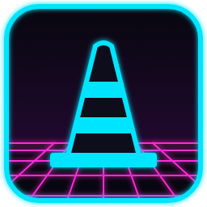

# Doll//Wave

A music player for Windows with a neon cyberpunk look, written in Rust.

The name mixes *doll* and *synthwave*, a nod to transfem culture. The
interface is styled like a dark HUD dashboard in cyan and magenta, and it
only comes with dark themes.



## Features

**Playback**

- Plays MP3, FLAC, WAV and OGG Vorbis files.
- Play / pause / stop, previous / next, shuffle and repeat.
- Smart shuffle: avoids playing the same artist or album twice in a row.
- 3-second fade-out at the natural end of a track.
- Normalized volume: every track sounds equally loud (ReplayGain tags, or
  an EBU R128 measurement done once in the background).
- Vinyl-style scratching: drag the progress bar and the sound follows,
  even backwards, then the "turntable" slows down smoothly.
- The progress bar shows the track's waveform; the volume is a 20-segment
  neon gauge (starts at 50% on each launch).
- Picks up where you left off: playlist, current track, position, shuffle
  and repeat are restored at launch.
- Follows the audio output when the system wakes up from sleep.

**Library and playlists**

- Library of all the music in your Music folder, browsable by folder,
  artist or album, with search.
- Favorites: star a folder or a track to move it to the top.
- Drag and drop files or folders onto the window.
- Reorder the play queue, save and load playlists.
- Automatic "Most played" playlist (recent plays count more).

**Lyrics, covers and tags**

- Synced lyrics (.lrc files), shown in white over the darkened album cover.
- One button fetches missing synced lyrics from [LRCLIB](https://lrclib.net).
- One button fetches missing album covers (MusicBrainz / Cover Art Archive,
  Deezer, iTunes) and saves them into the files.
- Items that could not be found are skipped until you click "retry" in the
  options.
- Full album cover shown over a blurred copy of itself.
- File info window, and an ID3 tag editor (one track or a whole folder).

**Visualizer**

- Four styles: frequency bars, oscilloscope, waveform, and "Ambience"
  (swirling colors in the spirit of Windows Media Player XP).
- Display capped at 30 frames per second during playback to save CPU.

**Windows integration**

- Custom neon title bar with the window buttons built in.
- Mini player: a small always-on-top window with cover, title, progress and
  controls.
- Closing the window tucks the player into the notification area (next to
  the clock); quit from the tray menu or from the options.
- Media keys on the keyboard and the Windows media panel (title, artist,
  album, cover).
- Double-clicking an audio file opens it in the running player.
- Optional CRT scanlines and glowing neon effects.

**Keyboard shortcuts**

| Key | Action |
| --- | --- |
| Space | Play / pause |
| S | Stop |
| ← / → | Previous / next track |
| Q / D | Back / forward 5 seconds |
| M | Mute |
| A | Shuffle |
| R | Repeat |
| Mouse wheel | Volume |

## Installation

Download the latest version from the
[Releases](https://github.com/lepapyfoufurieux/lecteur_mp3/releases) page.
Two files are available:

- `dollwave-installation.exe`: the installer. It installs the player for
  the current user only (no administrator rights needed), with an optional
  desktop shortcut and "Open with" for MP3 files. To make Doll//Wave the
  default player, right-click an MP3, choose "Open with", pick Doll//Wave
  and tick "Always".
- `dollwave.exe`: the portable version. Copy it anywhere and run it, nothing
  to install.

Settings are stored in `%APPDATA%\dollwave`.

## Building from source

Install Rust (https://rustup.rs), then in this folder:

```
cargo run --release
```

To build the standalone executable:

```
cargo build --release
```

It ends up in `target\release\dollwave.exe`. The fonts and the icon are
embedded in it.

To run the tests:

```
cargo test
```

The installer is built with [Inno Setup](https://jrsoftware.org/isinfo.php)
(version 6.6 or later) from `installateur\dollwave.iss`.

The player also builds on Linux (`libasound2-dev` is required). All the
system-specific code lives in `src/systeme.rs`, to make a full Linux port
easier later.

## Releases

GitHub Actions builds the `.exe` and the installer for every pull request.
Pushing a `v*` tag (for example `v0.2.0`) publishes a release with both
files attached.

## Built with

- [egui / eframe](https://github.com/emilk/egui) for the interface
- [rodio](https://github.com/RustAudio/rodio) and
  [symphonia](https://github.com/pdeljanov/Symphonia) for audio
- [rustfft](https://github.com/ejmahler/RustFFT) for the visualizer
- [souvlaki](https://github.com/Sinono3/souvlaki) for media keys and the
  media panel
- [id3](https://github.com/polyfloyd/rust-id3) for tags
